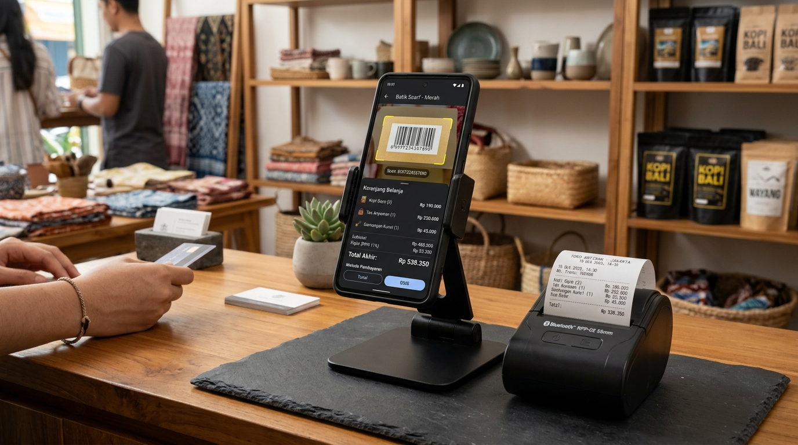
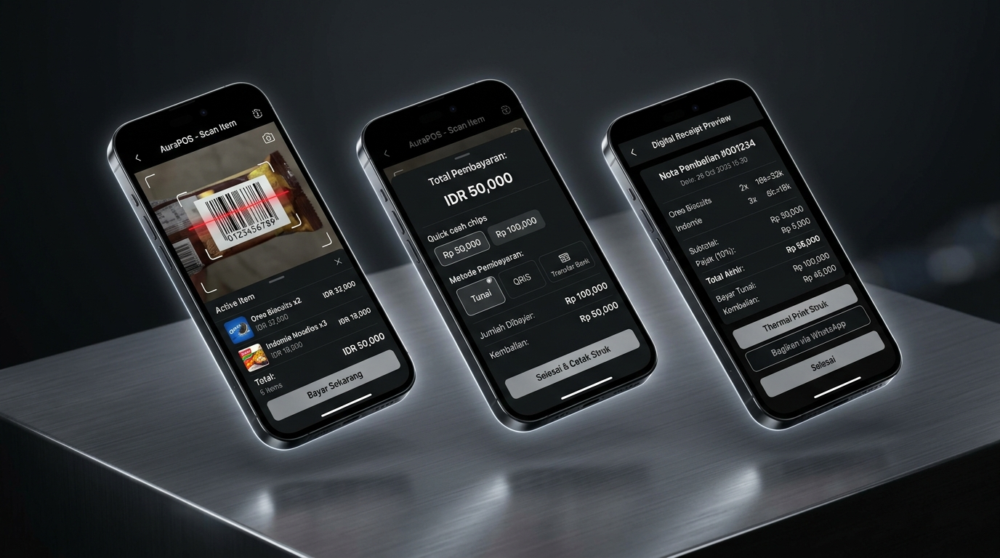

# Prawira Mobile Cashier

A high-performance mobile point-of-sale (POS) application built with React Native and Expo SDK 57. Engineered for fast-paced retail counter environments requiring continuous barcode/QR scanning, dual-mode unit pricing (packaged pieces and weight-based bulk items), ESC/POS Bluetooth thermal receipt printing, WhatsApp receipt dispatch, and offline-resilient Supabase synchronization.

## Commercial Overview & Hardware Showcase

### In-Situ Retail Deployment


The terminal operates on any smartphone mounted in an ergonomic counter stand paired with an external 58mm or 80mm Bluetooth thermal printer. It provides a compact, low-footprint cashier terminal suitable for boutiques, grocery counters, kiosks, and retail storefronts.

### Tri-Screen Workflow Cockpit


The operational interface is split into three high-velocity transactional stages:
1. Live Optical Viewfinder and Item Stream: Rapid scanning and instant cart insertion without interface reloads.
2. Cash Tender and Non-Cash Reconciliation: Dynamic cash denomination chips, live change calculation, QRIS prompt, and bank transfer routing.
3. Thermal Slip and WhatsApp Dispatch: One-tap ESC/POS receipt printing, formatted WhatsApp plain-text dispatch, and digital invoice sharing.

## Features

- Split-Cockpit Cashier UI: Upper 34% dedicated to continuous live camera barcode and QR scanning with an optical targeting reticle and torch control. Lower 66% dedicated to the active cart, quick favorite items, and sticky payment actions.
- Continuous Scanning Engine: Throttled barcode scanning (`useScannerThrottle`) prevents duplicate trigger loops while allowing cashiers to scan consecutive products without touching the display. Real-time haptic feedback (`expo-haptics`) confirms successful barcode capture.
- Commercial Store & Receipt Configuration (`StoreSettingsModal.tsx`):
  - Dynamic branding: Store name, physical address, phone/WhatsApp, and website/social handle.
  - Receipt parameters: 58mm mini-roll or 80mm wide-format ESC/POS output, header tagline, and customer footer notices.
  - Bank transfer details: Configurable bank institution (BCA, Mandiri, BRI, BNI), account number, and account holder name displayed during checkout.
  - Granular privacy toggles for showing or hiding address and contact details on printed receipts.
- In-App Inventory Registration (`AddProductModal.tsx`):
  - Add products directly from the sales floor with barcode auto-generator or manual entry.
  - Supports unit pricing (`pcs`) and weight pricing (`ons`, `gram`, `kg`).
  - Automatic category indexing and favorite shortcut pinning.
- Dual-Mode Pricing Engine:
  - Packaged items (`pcs`): Incremental quantity stepper (`-` / `+`).
  - Weight-based items (`ons`, `gram`, `kg`): One-tap quick weight chips (`1/2`, `1`, `2`, `5`) and manual decimal weight input. Supports half-unit pricing rules (`half_unit_price`).
  - Item-Level Adjustments: Modal for custom subtotals, bundle pricing (e.g. buy 2 for Rp 5,000), and custom discount notes.
- Multi-Method Tender Calculator:
  - Cash (Tunai): Dynamic tender suggestion chips (`Uang Pas`, `10k`, `20k`, `50k`, `100k`, and rounded values) with real-time change calculation and deficit warnings.
  - QRIS: Static QRIS/EDC instructions with formatted total amount.
  - Bank Transfer: Account details and verification workflow.
- Thermal and Digital Receipt Generation:
  - Bluetooth Thermal Printing (58mm / 80mm): Formats raw ESC/POS binary buffers sent directly to portable Bluetooth printers via the Android RawBT driver intent.
  - WhatsApp Digital Receipts: Generates itemized, formatted plain-text receipts and launches WhatsApp via deep linking (`whatsapp://send?text=...`).
  - System PDF Generation: Exports structured PDF invoices via `expo-print` and `expo-sharing`.
- Offline-Resilient Sync Architecture:
  - Local caching via `@react-native-async-storage/async-storage`.
  - Atomic stock decrement on Supabase via PostgreSQL RPC (`decrement_stock`) to prevent race conditions during concurrent transactions.
  - Automatic fallback queue for offline transactions, synchronizing once network connectivity returns.

## Tech Stack

- Framework: React Native 0.86, Expo SDK 57
- Language: TypeScript 6
- Camera & Scanner: Expo Camera (`CameraView`)
- Hardware Feedback: Expo Haptics
- Printing & Sharing: Expo Print, Expo Sharing, RawBT Android Driver (ESC/POS)
- Icons: Lucide React Native
- Database & Backend: Supabase (`@supabase/supabase-js`, PostgreSQL)
- Storage: React Native Async Storage

## Architecture and Data Flow

```text
[ Physical Barcode / QR ]
          |
          v
+-------------------------------+
|  CameraScanner (Expo Camera)  | ---> Haptic Feedback
+-------------------------------+
          |
          v (Product Detected)
+-------------------------------+
|       useCart Hook            | <---> Local Storage Cache (AsyncStorage)
|   - CartItem State            |
|   - Pricing & Weight Engine   |
+-------------------------------+
          |
          v (Checkout Action)
+-------------------------------+
|   CheckoutModal (Tender Calc) | ---> Cash / QRIS / Transfer
+-------------------------------+
          |
          +-----------------------------------+
          |                                   |
          v                                   v
+-----------------------+           +-----------------------+
| Supabase Sync         |           | Receipt Generation    |
| - decrement_stock RPC |           | - ESC/POS Thermal     |
| - orders Table        |           | - WhatsApp Plain Text |
| - order_items Table   |           | - PDF Share           |
| (Offline queue on err)|           +-----------------------+
+-----------------------+
```

## Directory Structure

```text
mobile-cashier/
├── assets/
│   ├── mockups/                  # Commercial hardware in-situ and workflow renders
│   └── ...                       # Application icons, splash screens, and adaptive assets
├── src/
│   ├── components/
│   │   ├── cart/
│   │   │   ├── CartItemRow.tsx        # Item row with weight chips, stepper, and actions
│   │   │   ├── CartSummaryBar.tsx     # Sticky bottom summary deck and checkout CTA
│   │   │   └── EditCartItemModal.tsx  # Bundle discount and custom subtotal editor
│   │   ├── catalog/
│   │   │   ├── AddProductModal.tsx    # In-app product registration (barcode, unit/weight)
│   │   │   └── ProductPickerModal.tsx # Product catalog browser with favorites tab
│   │   ├── checkout/
│   │   │   └── CheckoutModal.tsx      # Tender selection, dynamic cash chips, change calc
│   │   ├── printer/
│   │   │   └── BluetoothPrinterModal.tsx # RawBT status, setup guide, and test prints
│   │   ├── receipt/
│   │   │   └── ReceiptModal.tsx       # Thermal slip preview, print and share actions
│   │   ├── scanner/
│   │   │   └── CameraScanner.tsx      # Viewfinder, reticle overlay, torch, scan toast
│   │   └── settings/
│   │       └── StoreSettingsModal.tsx # Store branding, thermal paper, bank account config
│   ├── hooks/
│   │   ├── useCart.ts                 # Cart state management, pricing formulas, storage sync
│   │   ├── useProducts.ts             # Supabase fetcher, category indexing, offline cache
│   │   └── useScannerThrottle.ts      # Debounce logic and haptic feedback handler
│   ├── lib/
│   │   ├── constants.ts               # Store metadata, default receipt config, storage keys
│   │   ├── escpos-builder.ts          # ESC/POS byte generator and WhatsApp text formatter
│   │   ├── qr-helper.ts               # Barcode and QR parsing standard
│   │   ├── storage-adapter.ts         # AsyncStorage wrapper with device UID management
│   │   ├── supabase.ts                # Supabase client initialization
│   │   ├── thermal-printer.ts         # RawBT intent dispatch, PDF print, system print
│   │   └── theme.ts                   # Design system tokens (colors, typography, radii)
│   ├── screens/
│   │   └── CashierScreen.tsx          # Split-screen cashier cockpit
│   └── types/
│       ├── product.ts                 # Product, SellType, WeightUnit interfaces
│       └── transaction.ts             # CartItem, Order, PaymentMethod, ReceiptSettings
├── App.tsx                            # Root application entry
├── app.json                           # Expo app configuration and Android permissions
├── DESIGN.md                          # Design system specification and color guidelines
├── PRODUCT.md                         # Product context and domain constraints
├── supabase-migration.sql             # SQL migration schema and RPC definitions
├── tsconfig.json                      # TypeScript configuration
└── package.json
```

## Hardware and Peripheral Integration

### 1. Bluetooth Thermal Printer (58mm / 80mm)
The application generates standard ESC/POS command buffers:
- Initialization: `ESC @` (`0x1B 0x40`)
- Text alignment: Center, Left, Right (`ESC a`)
- Character sizing: Double-height, double-width for totals and headers (`GS !`)
- Paper feed and cut: `ESC d`, `GS V`

Printing is dispatched on Android via the RawBT Print Service:
- The app constructs a `rawbt:` deep-link URI containing base64-encoded ESC/POS bytes.
- If RawBT is not installed, the app prompts the user to download it from Google Play Store or falls back to system printing (`expo-print`).

### 2. Camera Viewfinder
Uses `expo-camera` (`CameraView`) set to the back camera. Throttling is handled in memory via `useScannerThrottle` using a 1,400ms interval to prevent duplicate reads of the same barcode while keeping the camera live.

## Database Schema and Migrations

Run the SQL migration in `supabase-migration.sql` inside your Supabase project SQL Editor:

```sql
-- 1. Add is_favorite column to products table
ALTER TABLE products
  ADD COLUMN IF NOT EXISTS is_favorite BOOLEAN DEFAULT false;

-- 2. Create atomic stock decrement RPC
CREATE OR REPLACE FUNCTION decrement_stock(p_product_id INT, p_qty NUMERIC)
RETURNS void
LANGUAGE sql
SECURITY DEFINER
AS $$
  UPDATE products
  SET in_stock = GREATEST(0, in_stock - p_qty)
  WHERE id = p_product_id;
$$;
```

### Required Supabase Tables

- `products`: `id`, `name`, `price`, `in_stock`, `category`, `sell_type` (`pcs` | `weight`), `weight_unit` (`ons` | `gram` | `kg`), `half_unit_price`, `barcode`, `is_favorite`.
- `orders`: `id`, `order_number`, `total_amount`, `subtotal`, `final_amount`, `payment_method`, `payment_status`, `order_status`, `customer_name`, `user_uid`, `notes`, `created_at`.
- `order_items`: `id`, `order_id`, `product_id`, `product_name`, `quantity`, `unit_price`, `total_price`.

## Getting Started

### Prerequisites

- Node.js 18.x or later
- npm or yarn
- Expo Go app on mobile (Android or iOS) or an Android Emulator / physical device

### Installation

1. Clone the repository:
   ```bash
   git clone <repository-url>
   cd mobile-cashier
   ```

2. Install dependencies:
   ```bash
   npm install
   ```

3. Configure Supabase credentials:
   Create or verify environment variables in `.env` (or configure in `src/lib/supabase.ts`):
   ```text
   EXPO_PUBLIC_SUPABASE_URL=https://your-project.supabase.co
   EXPO_PUBLIC_SUPABASE_ANON_KEY=your-anon-key
   ```

4. Start the development server:
   ```bash
   npx expo start
   ```

### Running on Device / Emulator

- Android Emulator:
  ```bash
  npm run android
  ```
- Physical Android Device:
  Install the Expo Go app from Google Play Store, start the server with `npx expo start`, and scan the terminal QR code.
- iOS Simulator:
  ```bash
  npm run ios
  ```

## Quality Verification

Run TypeScript verification before pushing code:

```bash
npx tsc --noEmit
```

Diagnose dependencies:

```bash
npx expo-doctor
```

## Production Builds with EAS

Build an installable Android APK / AAB using EAS Build:

```bash
npm install -g eas-cli
eas login
eas build --platform android --profile preview
```

## License

This project is licensed under the MIT License. See the LICENSE file for details.
